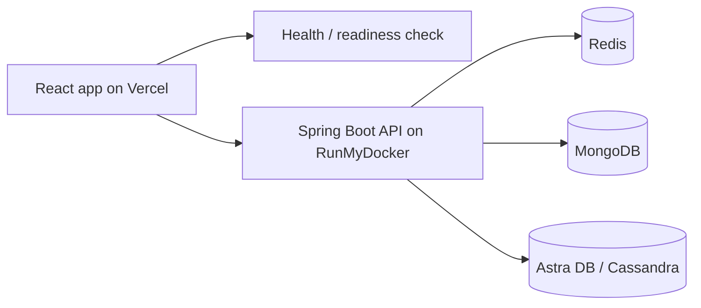

# TinyURL — React Frontend

The **React 19 + TypeScript** interface for a full-stack URL shortening and click analytics application. Users can create accounts, generate short links, open redirects, and explore click activity through a single web interface.

**Live demo:** https://etinyurl.vercel.app/  
**Backend API:** https://url.runmydocker-app.com/  
**Backend repository:** https://github.com/elad9219/tinyurl  
**API documentation:** https://url.runmydocker-app.com/swagger-ui/index.html

## Features

- **Create User:** Register a username and receive feedback if it already exists.
- **Create Tiny URL:** Submit a long URL for an existing user and receive a shareable short link.
- **User Information:** Look up the user's short links and aggregated click counts.
- **Click Details:** Inspect link click history, including timestamps and destination URLs.
- **Server readiness handling:** Check the backend health endpoint and queue a requested action while a sleeping demo server becomes available.
- **Resilient requests:** Retry eligible read-only requests on transient network/server failures; avoid blindly retrying writes that could create duplicates.
- **Special-character usernames:** Encode usernames as query parameters, including names containing `/`.

## Technology stack

| Area | Technologies |
| --- | --- |
| UI | React 19, React DOM, TypeScript 4.9 |
| HTTP | Axios |
| Tests | React Testing Library, Jest (through React Scripts) |
| Build tooling | Create React App / `react-scripts` 5.0.1 |
| Deployment | Vercel |
| Backend | Java 21, Spring Boot 4.1.2 |
| Data services (via API) | Redis, MongoDB Atlas, Astra DB / Cassandra |

The current project still uses **Create React App**. Moving to a modern build tool such as Vite is a potential future improvement, not part of the deployed upgrade.

## How it works



The frontend communicates with the backend over HTTP(S). It does not connect directly to the databases.

### Backend readiness and queued actions

The public demo backend may be sleeping when a visitor arrives. The interface checks `/actuator/health` and allows the visitor to initiate an action while the service wakes up. The requested operation runs when the backend becomes ready. This helps avoid repeated manual clicks during startup.

For transient failures, the Axios instance retries **read-only GET requests** in eligible cases. It does not automatically replay POST requests, which could accidentally duplicate user creation or short-link generation.

## Run locally

### Requirements

- Node.js and npm compatible with the project's dependencies
- A running TinyURL backend reachable on port `8080`

Clone and install:

```bash
git clone https://github.com/elad9219/tinyurl-frontend.git
cd tinyurl-frontend
npm ci
```

Start the frontend:

```bash
npm start
```

By default, the development UI runs at `http://localhost:3000` and uses the backend at `http://localhost:8080`.

### Tests and production build

```bash
CI=true npm test -- --watch=false --runInBand
npm run build
```

The application is deployed to Vercel from the repository's production branch.

## API configuration

API URLs are centralized in `src/utils/globals.ts`:

| Environment | Backend URL |
| --- | --- |
| Local development | `http://<browser-hostname>:8080` |
| Production | `https://url.runmydocker-app.com` |

The frontend uses these API routes:

| Method | Endpoint | Purpose |
| --- | --- | --- |
| `POST` | `/user?name={username}` | Create user |
| `GET` | `/user?name={username}` | Load user details |
| `POST` | `/tiny` | Create shortened URL |
| `GET` | `/user/clicks?name={username}` | Load click history |
| `GET` | `/actuator/health` | Check backend readiness |

Usernames are URL-encoded when used in query parameters.

## Screenshots

*Screenshots below are from an earlier version of the interface and are kept as project references. The live UI may have minor differences.*

### Homepage


### Create User


### Create Tiny URL


### User Information


### Click Details


## Related resources

- [Live TinyURL demo](https://etinyurl.vercel.app/)
- [TinyURL backend source](https://github.com/elad9219/tinyurl)
- [Backend Swagger UI](https://url.runmydocker-app.com/swagger-ui/index.html)

## Author

**Elad Tennenboim**  
[GitHub](https://github.com/elad9219) · [LinkedIn](https://www.linkedin.com/in/elad-tennenboim/) · [Email](mailto:elad9219@gmail.com)
